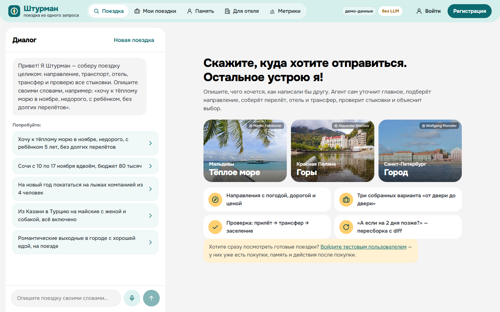
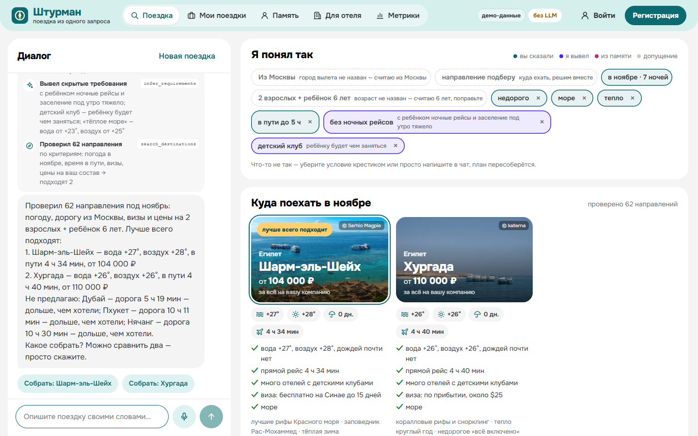
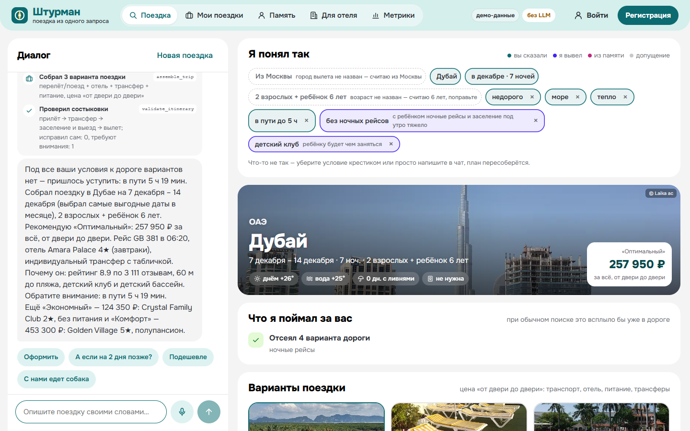
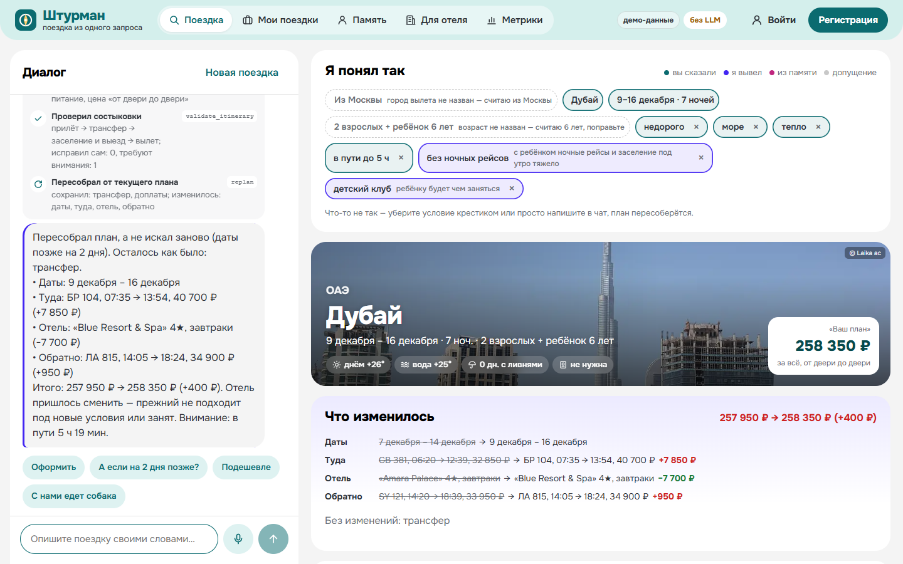
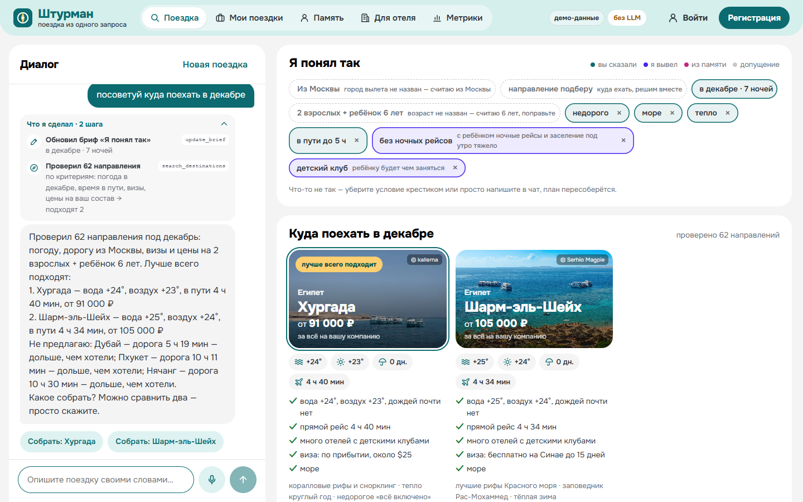
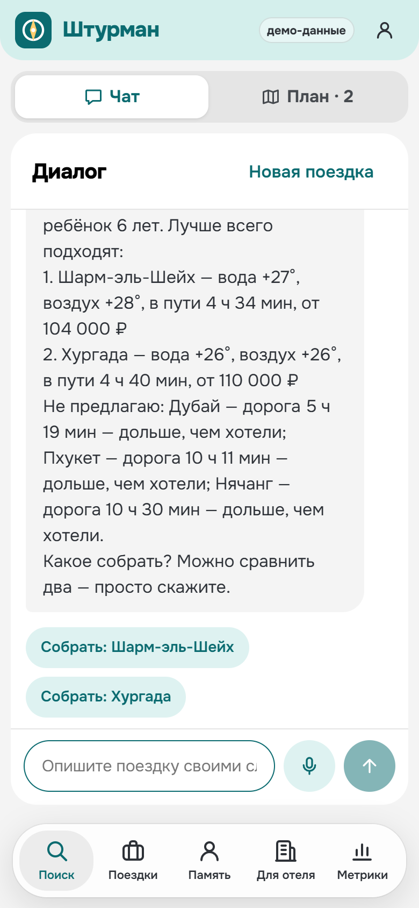
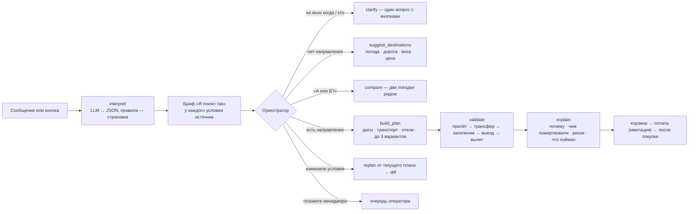

# Штурман — поездка из одного запроса

AI-агент для путешествий: из одного сообщения вроде «хочу к тёплому морю в ноябре, недорого, с ребёнком, без долгих перелётов» собирает готовую поездку — направление, перелёт или поезд, отель, трансфер — проверяет стыковки, объясняет выбор, пересобирает план, когда условия меняются, и доводит до оформления (оплата имитируется). После покупки помогает дальше: ранний заезд, перенос дат, план Б при сбое, памятка, напоминания.

Проект запускается локально одной командой (ниже).

> **Честно о данных.** Отели, рейсы, поезда, трансферы и цены — синтетические (в интерфейсе бейдж «демо-данные»). Реальные: география и время в пути, климат по месяцам и прогноз погоды (Open-Meteo), визовые режимы, фото направлений. Оплата и бронирование имитируются. Подробно — в разделе [Сидирование и данные](#сидирование-и-данные). Проект не связан ни с одной туристической компанией.

## Как это выглядит


| | |
|---|---|
|  |  |
| Старт: чат слева, примеры запросов и что умеет агент | «Я понял так»: каждое условие с источником, направления с погодой, дорогой и визой |
|  |  |
| Собранная поездка: цена «от двери до двери», что агент поймал за вас, варианты | Пересборка от текущего плана: что осталось и что изменилось |
|  |  |
| Вдохновение: направления по месяцу с объяснением выбора | На телефоне чат и план — вкладками |

Экраны сняты с локального запуска без ключа LLM: весь путь работает на правилах, данные синтетические.

## Авторы

Проект сделан в октябре 2026 года на хакатоне командой из четырёх человек. Этот репозиторий — моя копия для портфолио, её веду я.

- **[@grozeser](https://github.com/grozeser)** (я): архитектура и ядро агента — разбор запроса (LLM и правила), планировщик, проверка стыковок с авто-исправлением, пересборка от текущего плана; интерфейс чата и плана; Docker; эталонный прогон и метрики; Telegram-бот с напоминаниями; своя LLM на Ollama; маршруты из нескольких городов и любой город мира; календарь цен, памятка и `.ics`, план Б, поездка компанией, карта; проверка на «злых» запросах и сквозные тесты.
- **[@ncmapls](https://github.com/ncmapls)**: сравнение направлений, лайфхаки из расписаний, прогноз погоды, доступная среда, особое питание, страховка и проверка паспорта, передача диалога менеджеру, «сколько времени вы сэкономили».
- **[@dppauk](https://github.com/dppauk)**: визуальный стиль, фото направлений, вход и регистрация, раскладка экрана.
- **[@ro1z1X](https://github.com/ro1z1X)**: ревью и слияние изменений дизайна.

Код соавторов остаётся их кодом; лицензия на повторное использование не выдаётся.

## Содержание

1. [Быстрый старт](#быстрый-старт)
2. [Попробуйте за 5 минут](#попробуйте-за-5-минут)
3. [Что ещё умеет агент](#что-ещё-умеет-агент)
4. [Зависимости и переменные окружения](#зависимости-и-переменные-окружения)
5. [Сидирование и данные](#сидирование-и-данные)
6. [Маршруты и доступ](#маршруты-и-доступ)
7. [Как устроен агент](#как-устроен-агент)
8. [Своя LLM без внешних API](#своя-llm-без-внешних-api)
9. [Метрики и проверки качества](#метрики-и-проверки-качества)
10. [Структура репозитория](#структура-репозитория)
11. [Разработка без Docker](#разработка-без-docker)
12. [Если что-то не работает](#если-что-то-не-работает)
13. [Стек и лицензии](#стек-и-лицензии)

## Быстрый старт

Нужен только Docker с Compose (Docker Desktop на Windows и macOS).

```bash
git clone https://github.com/grozeser/shturman.git
cd shturman
cp .env.example .env      # необязательно: без .env берутся значения из .env.example
docker compose up --build
# открыть http://localhost:8080
```

- **Сколько ждать.** Первая сборка — 1–3 минуты (зависит от скорости скачивания базовых образов; на 4-ядерном ноутбуке с уже скачанными образами — около 50 секунд). Готовность: в `docker compose ps` оба сервиса `healthy`, `curl http://localhost:8080/health` отвечает `{"status":"ok"}`.
- **Ключ LLM не нужен.** Весь путь от запроса до оплаты работает на правилах. Подключение LLM описано [ниже](#зависимости-и-переменные-окружения).
- **Регистрация не нужна.** Каждый браузер получает анонимный идентификатор, по нему агент помнит предпочтения и поездки. Чтобы сразу увидеть готовые поездки и память, войдите тестовым пользователем: «Войти» в шапке → один клик (`marina@demo.shturman` / `demo123`).
- **Порт 8080 занят?** Укажите в `.env` `APP_PORT=8081` и откройте http://localhost:8081. Внутри контейнера приложение всё равно слушает 8080.
- **Остановить:** `docker compose down` (данные сохранятся в томе `pgdata`; `docker compose down -v` — начать с чистой базы).

## Попробуйте за 5 минут

Вставляйте запросы в чат на главной странице. Всё работает без ключа LLM; ответы приходят за доли секунды.

### Главный путь

| Шаг | Что написать или нажать | Что увидите |
|---|---|---|
| **1. Понимание запроса и уточнение** | `хочу к морю, недорого` | Ровно **один** вопрос («когда и кто едет?») с кнопками-ответами вроде «В ноябре вдвоём» — а не анкета |
| | `хочу к тёплому морю в ноябре, недорого, с ребёнком, без долгих перелётов` | Карточка **«Я понял так»**: каждое условие с источником — *вы сказали*, *я вывел* (с причиной: «с ребёнком → без ночных рейсов, перелёт до 5–6 ч, детский клуб»), *из памяти*, *допущение*. Любое условие убирается крестиком, план пересобирается |
| **2. Вдохновение и выбор направления** | `посоветуй куда поехать в декабре` | 3–4 направления с погодой и водой по месяцу, дорогой, визой и ценой «от двери до двери», «почему именно это» — и честно, почему не предложены другие («дорога 10 ч — дольше, чем хотели») |
| **3. Подбор и сравнение** | `Дубай в декабре вдвоём` | До трёх собранных вариантов (оптимальный, экономный, комфорт) и таблица сравнения **не только по цене**: условия отмены, питание, до моря, время в пути, детский клуб, балл пригодности |
| **4. Объяснение выбора** | тот же план | У каждого варианта — «почему он», «чем пожертвовали», риски. Карточка **«Что я поймал за вас»**: прилёт задолго до заселения — исправлен, отсеянные рейсы и отели с причиной, ловушка «отель дешевле на 450 ₽, но в итоге дороже». Ползунки приоритетов (цена, комфорт, время в пути, море, гибкость) пересобирают варианты |
| **5. Сборка поездки и покупка** | тот же план → «Оформить» | Таймлайн «прилёт → трансфер → заселение → выезд → вылет» с проверкой каждой стыковки, корзина одной поездкой, финальная проверка перед оплатой, **имитация оплаты**, ваучер-билет |
| **6. Пересборка плана** | `а если на 2 дня позже?`, `подешевле`, `с нами едет собака` | План перестраивается **от текущего**, а не ищется заново: блок «что осталось как было / что изменилось и на сколько». **Календарь ±3 дня** над планом: цена той же поездки на каждый день заезда, клик даёт ровно обещанную цену |

### После покупки и вокруг

| Возможность | Что сделать | Что увидите |
|---|---|---|
| **Работа после покупки** | Оформить поездку → «Открыть поездку» | Ранний заезд, поздний выезд, индивидуальный трансфер, перенос дат, отмена — всегда сначала расчёт, потом «Подтвердить». **План Б**: «Если отменят рейс туда» / «Если отель не заселит» — агент сам собирает замену. Памятка «что взять» по погоде, составу и визе, «Добавить в календарь» (`.ics`), напоминания |
| **Память и персонализация** | «Войти» → Марина → `как в прошлый раз, но в горы` | Состав и город вылета — из памяти, длительность и месяц — из прошлой поездки (помечено «из памяти»), меняется только место. Что агент помнит — на странице «Память», любой пункт можно забыть |
| **Метрики качества агента** | вкладка «Метрики» | Эталонный прогон 47 запросов: доведено до оплаты, уточнений, ходов и времени до первой рекомендации, ошибок стыковок, нарушений ограничений. Плюс воронка и средний чек для бизнеса |
| **Мобильная версия / мессенджер** | открыть сайт с телефона; Telegram-бот | На телефоне чат и план — вкладками. Тот же агент в Telegram (см. [Маршруты и доступ](#маршруты-и-доступ)): напоминания о регистрации, выезде в аэропорт и сроке бесплатной отмены приходят сами |

### Для кого

| Кто | Где это видно |
|---|---|
| **Путешественник** — описать поездку своими словами и получить понятный план | Весь путь выше: одно сообщение → план с вариантами и объяснением → оплата. Перед оплатой — «Сэкономили около N мин: столько-то сообщений вместо десятков кликов по 5 сайтам» (цифры из следа агента: сколько направлений, отелей, рейсов и дат он сравнил) |
| **Сервис бронирования** — продажа поездки целиком внутри сервиса, конверсия и средний чек | Цена «от двери до двери» и корзина одной поездкой, допродажи (питание, трансфер, ранний заезд, страховка), воронка и средний чек на «Метриках» |
| **Отель** — гости, которым он действительно подходит | Вкладка **«Для отеля»**: балл пригодности по типам гостей (семьи, пары, с питомцем, на коляске…), кому агент отель не покажет и почему, что изменить, чтобы приходили «свои» гости |

## Что ещё умеет агент

| Попробуйте | Что произойдёт |
|---|---|
| `Турция или Египет в мае вдвоём?` | **Сравнение направлений**: две собранные поездки рядом — цена, погода и вода, дорога, виза, отель, плюсы и минусы друг против друга, «мой выбор» и кнопка «Беру эту» (план после неё совпадает со сравнением до рубля) |
| `3 ночи в Стамбуле и 4 в Каппадокии в мае вдвоём` | **Маршрут из нескольких городов**: у каждой части свой отель и проверки, переезд в тот же день, оплачивается один раз |
| `лиссабон на 5 дней в октябре` | **Любой город мира**: города нет в каталоге — агент находит его на карте, берёт реальный климат и собирает поездку, прямо предупреждая, что отели смоделированы |
| `Сочи в июне, мама на коляске` | **Доступная среда**: только отели с доступными номерами, минивэн с подъёмником, прямые рейсы, предупреждение авиакомпании и отеля в ваучере |
| `Анталья в июле вдвоём, едим халяль` | **Особое питание** (халяль, вегетарианское, без глютена, без лактозы, аллергия на орехи): только отели, где кухня это умеет, предупреждение отелю, карточка аллергика в памятке |
| `Петербург на выходные вдвоём` | **Лайфхаки из расписаний**: ночной поезд вместо ночи в отеле, город на длинной пересадке, рейс попозже — с ценой и кнопкой «применить» |
| `Сочи через неделю вдвоём` | **Настоящий прогноз погоды** на даты поездки (Open-Meteo, до 16 дней вперёд) вместо многолетней нормы; за 3 дня до вылета бот пишет прогноз сам |
| Корзина → галочка «Страховка» | **Страховка одной галочкой** по стране, дням и возрасту + **проверка загранпаспорта**: `паспорт до 10.03.2027` → «Египет требует 6 месяцев после выезда — с таким не пустят» |
| План → «Едете компанией?» | **Поездка компанией**: ссылка для попутчиков, каждый видит свою долю и голосует без регистрации, организатор выбирает вариант большинства |
| План → «Поездка на карте» | **Карта**: город вылета, города поездки и маршрут (OpenStreetMap) |
| `позовите живого менеджера` | **Передача человеку**: диалог уходит в консоль оператора `/operator` с брифом, планом и всеми шагами агента; менеджер отвечает прямо в чат |
| `расскажи анекдот`, `в сочм в декабре`, `$1500 на двоих в египет` | **Незнакомые и «злые» запросы**: вежливое «я про поездки», опечатки, валюта по курсу с пометкой «допущение» |

## Зависимости и переменные окружения

**Рекомендуемые ресурсы:** 2 CPU, 2 ГБ RAM (работающий стенд занимает около 300 МБ, образ приложения — около 300 МБ), Docker с Compose v2.24+.

**Сеть:** нужна для сборки образов. В работе стенд обращается наружу только к открытым API Open-Meteo (город вне каталога, прогноз погоды) и к LLM, если она подключена. Без сети всё работает: вместо прогноза — климатическая норма, вместо незнакомого города — похожие из каталога.

| Сервис (`docker-compose.yml`) | Что делает |
|---|---|
| `app` | FastAPI: API агента, поток шагов агента (SSE) и собранный React-интерфейс — всё на порту 8080. Healthcheck — `/health` |
| `db` | PostgreSQL 16: диалоги, брони, память, голоса попутчиков, очередь оператора. Healthcheck — `pg_isready`; `app` стартует после него |
| `bot` | Telegram-бот на том же ядре агента (профиль `telegram`, запускается только по желанию) |

| Переменная | По умолчанию | Назначение |
|---|---|---|
| `APP_PORT` | `8080` | Порт на вашем компьютере (внутри контейнера всегда 8080) |
| `POSTGRES_DB` / `POSTGRES_USER` / `POSTGRES_PASSWORD` | `shturman` / `shturman` / `shturman` | База данных; строку подключения `DATABASE_URL` compose собирает сам |
| `LLM_BASE_URL` | пусто | OpenAI-совместимый API (OpenRouter, YandexGPT, vLLM, Ollama…). Пусто — режим на правилах |
| `LLM_API_KEY` | пусто | Ключ, если сервис его требует. В репозиторий не коммитится |
| `LLM_MODEL` | пусто | Имя модели, например `openai/gpt-4.1-mini` |
| `LLM_TIMEOUT_SECONDS` | `30` | Сколько ждать модель, потом — переход на правила |
| `LLM_NARRATE` | `true` | LLM переписывает ответы живым языком; ответ с числом, которого нет в расчётах, отбрасывается |
| `LOCAL_LLM_MODEL` | `qwen3:4b-instruct` | Модель для своей LLM в Docker (`docker-compose.local-llm.yml`) |
| `TELEGRAM_BOT_TOKEN` | пусто | Токен бота от @BotFather (только для профиля `telegram`) |
| `OPERATOR_KEY` | `operator-demo` | Ключ консоли оператора `/operator`; на настоящем стенде задайте свой |
| `TODAY` | пусто | Зафиксировать «сегодня» (`YYYY-MM-DD`) для воспроизводимого демо; пусто — настоящая дата |
| `FORECAST_OFFLINE` | пусто | `1` — не запрашивать прогноз погоды, показывать климатическую норму |
| `LOG_LEVEL` | `INFO` | Подробность логов (`docker compose logs app`) |

Служебные, менять обычно не нужно: `GEO_TIMEOUT_SECONDS` (8), `FORECAST_TIMEOUT_SECONDS` (5), `GEO_OFFLINE` (тесты и эталонный прогон без сети).

## Сидирование и данные

**Отдельной команды не нужно** (`make seed` только напоминает об этом). При старте `app` сам создаёт таблицы и трёх тестовых пользователей с готовыми поездками. Справочники и инвентарь вшиты в образ и генерируются детерминированно: один и тот же запрос всегда даёт одну и ту же выдачу.

| Данные | Источник |
|---|---|
| 62 направления, 20 городов вылета, координаты, часовые пояса, визовые режимы для граждан РФ, закрытые аэропорты юга России | вручную, по открытым данным |
| Климат по месяцам: дневной максимум, температура моря, дни с ливнями | **реальные** средние за 2015–2024 (вода — 2022–2024), Open-Meteo (CC BY 4.0); запечены скриптом `scripts/fetch_climate.py` |
| Прогноз погоды на даты поездки | **реальный** прогноз Open-Meteo на 16 дней от настоящей даты, кэш 3 часа; дальше или без сети — норма |
| Время в пути | из реальных расстояний и часовых поясов |
| Город вне каталога | **реальные** координаты и страна (геокодер Open-Meteo), климат и вода из архива за 6 лет; отели и рейсы моделирует тот же генератор — агент прямо пишет об этом |
| Отели, рейсы, поезда, трансферы, цены, наличие мест, кухня, страховые тарифы | **синтетика**: вымышленные названия, детерминированный генератор |
| Фото направлений | **реальные** снимки с Wikimedia Commons под свободными лицензиями (CC0, CC BY, CC BY-SA), автор — в углу фото, список — `frontend/public/photos/CREDITS.md` |
| Фото отелей | иллюстрации по типу отеля с Wikimedia Commons, подписаны «фото для примера» |
| Оплата и бронирование | **имитация**: деньги не списываются, данные карт не запрашиваются |

## Маршруты и доступ

| Адрес | Что там |
|---|---|
| `/` | Агент: чат слева, план справа (на телефоне — вкладки «Чат» и «План») |
| `/trips`, `/trips/:id` | Мои поездки: ваучер, действия после покупки, план Б, памятка, файл для календаря, напоминания, история |
| `/profile` | Аккаунт и «что агент помнит о вас» — любой пункт можно забыть |
| `/hotels` | Для отеля: кому агент рекомендует отель, кому нет и что изменить |
| `/metrics` | Метрики качества агента и воронка для бизнеса |
| `/share/:token` | Поездка компанией: варианты, доля каждого и голосование — без регистрации |
| `/operator` | Консоль оператора (ключ `operator-demo`): очередь обращений, которые агент передал людям |
| `/login`, `/register` | Вход (тестовые пользователи — в один клик) и регистрация; поездки и память браузера переходят в аккаунт |
| `/health` | `200 OK`, `{"status": "ok"}` |
| `/api/docs` | Swagger UI со всеми методами API |

**Тестовые пользователи** (создаются при старте, их поездки собирал тот же агент):

| Почта | Пароль | Кто | Поездки |
|---|---|---|---|
| `anna@demo.shturman` | `demo123` | семья с ребёнком | Шарм-эль-Шейх, Анталья (с ранним заездом), Сочи |
| `ilya@demo.shturman` | `demo123` | горнолыжник | Красная Поляна, Шерегеш, Гудаури (отменена) |
| `marina@demo.shturman` | `demo123` | пара, города и еда | Стамбул, Тбилиси, Санкт-Петербург, Ереван |

Пароли хранятся хешем (scrypt). Консоль оператора: `/operator`, ключ `operator-demo` (задаётся `OPERATOR_KEY`).

**Telegram-бот.** Создайте бота у @BotFather, впишите токен в `.env` (`TELEGRAM_BOT_TOKEN=...`) и запустите:

```bash
docker compose --profile telegram up --build     # или make bot
```

В боте тот же агент: кнопки быстрых ответов, оформление (`Анна, anna@example.com`), напоминания приходят сами, `/remind` присылает ближайшее сразу, `/new` — новая поездка. Токен в логи не попадает.

## Как устроен агент

**Главный принцип: LLM понимает и объясняет, инструменты считают.** Цены, время в пути, стыковки и итоговые суммы считает только детерминированный код. LLM (если подключена) разбирает свободный текст в структуру и переписывает ответы; ответ с числом, которого нет в расчётах, отбрасывается и заменяется шаблонным. Поэтому агент не выдумывает цены и расписания.



**Когда агент спрашивает, а когда действует:**

- Спрашивает **максимум один раз** и только то, без чего нельзя проверить погоду и цены: когда едете (и кто, если тоже неизвестно). Один вопрос, ответы кнопками.
- Остальное достраивает сам и показывает в «Я понял так» с источником каждого условия. Условие убирается в один клик — план пересобирается.
- Направление известно — сразу собирает поездку. Неизвестно — предлагает до четырёх направлений, которые подходят под все условия, с объяснением и причинами, почему не другие. Если подходят только два (например, с ребёнком и без долгих перелётов в ноябре), агент так и показывает два, а не добивает список неподходящими.
- Если в направлении ничего не подходит (например, с собакой некуда заселиться), агент не упирается в тупик, а сам ищет, куда можно.
- Если города нет в каталоге, агент находит его на карте; страну превращает в подходящий город (Норвегия → Берген, Греция → Ираклион).
- Каждый шаг агента виден в чате: «Проверил 62 направления», «Отели в Сочи: 18 → 12 подходят», «Проверил стыковки: исправил сам 1».

**Чем каждый этап лучше обычного поиска:**

- **Цена «от двери до двери»** — перелёт, отель, питание, трансферы и доплаты одной суммой.
- **Даты** — если назван только месяц, агент сравнивает все заезды и берёт самый выгодный; **календарь ±3 дня** показывает цену той же поездки на соседние дни.
- **Проверка стыковок с авто-исправлением** — ночной прилёт → номер с ночи прилёта; групповой трансфер ночью не ходит → такси; долго ждать вылета с ребёнком → поздний выезд.
- **Пересборка, а не новый поиск** — сохраняет выбранный вариант, отель и похожие рейсы; «подешевле» уступает по шагам: тариф → трансфер → рейс → питание → отель.
- **«Что я поймал за вас»** — то, что при обычном поиске всплыло бы уже в дороге.
- **План Б после покупки** — замена рейса или отеля без доплаты за то, что не изменилось; ничего не меняется до подтверждения.
- **Для отеля** — агент рекомендует отель тем, кому он подходит, и объясняет отелю, кому и почему.

## Своя LLM без внешних API

Запросы путешественников не уходят ни в какой облачный сервис: модель работает в соседнем контейнере. Этот вариант можно забрать в бизнес как есть.

```bash
docker compose -f docker-compose.yml -f docker-compose.local-llm.yml up --build    # или make local-llm
```

| Что | Значение |
|---|---|
| Движок | Ollama 0.35.1, OpenAI-совместимый API внутри сети Docker |
| Модель по умолчанию | `qwen3:4b-instruct` (2,5 ГБ, лицензия Apache 2.0), меняется через `LOCAL_LLM_MODEL` |
| Первый запуск | скачивание модели — около 10 минут на 30 Мбит/с, дальше старт за ~20 секунд |
| Скорость на CPU | 20–80 секунд на разбор сообщения (4-ядерный Ryzen 3, без видеокарты); с GPU — секунды |
| Память | ~5,5 ГБ на контейнер с моделью |

Замер на 10 сценариях эталона на CPU: все 10 доведены до корзины, верно разобрано 36 полей из 37 (единственный промах — бюджет в долларах — исправлен: валюту считают правила по курсу с пометкой «допущение»), медиана — 66 секунд на сценарий из 4 ходов. Если модель не ответила вовремя, агент продолжает на правилах — пользователь не застревает. Визу, погоду, время в пути и приветствия всегда отвечают шаблоны по данным: так честнее и быстрее.

## Метрики и проверки качества

**Эталонный прогон** — 47 запросов: размытые, конкретные, с детьми, с питомцем, с бюджетом на человека и в долларах, без визы, вне каталога, с опечатками, маршрут из двух городов. Каждый агент проводит по сценарию «запрос → ответ на уточнение → направление → „на 2 дня позже“ → оформить».

| Метрика (режим на правилах) | Значение |
|---|---|
| Доведено до оплаты | **100%** (47 из 47) |
| Уточнений на запрос | 0,06 в среднем, максимум 1 |
| Ходов до первой рекомендации | 1,06 |
| Ошибок стыковок в итоговом плане | **0** |
| Нарушений ограничений (ночной рейс с ребёнком, бюджет, питомец, поезд) | **0** |
| Точность разбора запроса | **100%** |
| Пересборка без смены отеля | 85% |

**Все проверки проекта:**

| Что | Команда | Результат |
|---|---|---|
| Эталонный прогон (отчёт — на странице «Метрики») | `docker compose exec app python -m app.eval` или `make eval` | 47/47 |
| Тесты бэкенда: веб, бот, разбор, планировщик, все фичи | `cd backend && pytest -q` или `make test` | 118 тестов |
| «Злые» запросы: опечатки, сленг, валюта, смена мнения, не о поездке | `make redteam` | 99 диалогов, 0 падений |
| Сквозные тесты в браузере (Playwright), десктоп и телефон | `make up && make e2e` | 4/4 |
| Линтер | `ruff check backend scripts` | без замечаний |

CI (`.github/workflows/ci.yml`): ruff, pytest, eval, сборка фронтенда и Docker-образа на каждый push.

## Структура репозитория

```text
├── docker-compose.yml            # app + db (+ bot по профилю telegram)
├── docker-compose.local-llm.yml  # своя LLM в Docker (Ollama)
├── Dockerfile                    # multi-stage: сборка фронтенда → зависимости → лёгкий рантайм без root
├── .env.example                  # все переменные с безопасными значениями по умолчанию
├── Makefile                      # up, down, logs, seed, eval, test, redteam, e2e, local-llm, bot
├── backend/
│   ├── app/
│   │   ├── main.py               # HTTP API, раздача фронтенда, /health
│   │   ├── bot.py                # Telegram-бот на том же ядре
│   │   ├── store.py              # хранилище (SQLAlchemy): диалоги, брони, память, голоса
│   │   ├── accounts.py           # аккаунты и тестовые пользователи
│   │   ├── agent/                # оркестратор, разбор запроса (LLM + правила), ответы, после покупки, оператор
│   │   ├── travel/               # бриф, каталог, инвентарь, планировщик, геокодер, прогноз, сравнение
│   │   ├── eval/                 # эталонный набор (cases.json) и прогон метрик
│   │   └── data/                 # направления, климат, города вылета, отчёт эталона
│   └── tests/                    # pytest
├── frontend/                     # React 18 + TypeScript + Vite; страницы в src/pages, компоненты в src/components
├── e2e/                          # сквозные тесты Playwright
└── scripts/                      # redteam.py, demo_dialogue.py, fetch_climate.py, fetch_photos.py
```

## Разработка без Docker

```bash
cd backend && python -m venv .venv && .venv/Scripts/pip install -r requirements-dev.txt   # Linux/macOS: .venv/bin/pip
uvicorn app.main:app --port 8000          # API на :8000, база — SQLite в ./shturman.db
cd frontend && npm ci && npm run dev      # интерфейс на http://127.0.0.1:5190, прокси на :8000
cd backend && pytest -q                   # тесты
python ../scripts/demo_dialogue.py "хочу к морю в ноябре с ребёнком" "1" "а если на два дня позже?"   # диалог в консоли
```

| Команда | Что делает |
|---|---|
| `make up` / `make down` | поднять / остановить стенд |
| `make logs` | логи приложения |
| `make seed` | демо-данные создаются сами при старте — команда только напоминает об этом |
| `make eval` | эталонный прогон, отчёт на «Метриках» |
| `make test` | тесты бэкенда |
| `make redteam` | «злые» запросы |
| `make e2e` | сквозные тесты в браузере против запущенного стенда |
| `make local-llm` | стенд со своей LLM в Docker |
| `make bot` | стенд + Telegram-бот |

## Если что-то не работает

| Симптом | Что делать |
|---|---|
| `port is already allocated` / страница не открывается на 8080 | Порт занят другой программой: `APP_PORT=8081` в `.env`, открыть http://localhost:8081 |
| `Cannot connect to the Docker daemon` | Запустите Docker Desktop и дождитесь «Engine running» |
| Долгая первая сборка | Скачиваются базовые образы (node, python, postgres) — один раз; повторный запуск — секунды |
| `app` не становится `healthy` | `docker compose logs app` — причина будет в логе; затем `docker compose down -v && docker compose up --build` для чистой базы |
| Mac с Apple Silicon | Образ собирается нативно под arm64 (проверено сборкой под `linux/arm64`). Если нужен amd64-образ — раскомментируйте `platform: linux/amd64` в `docker-compose.yml` |
| Нет интернета | Всё работает; вместо прогноза — климатическая норма, вместо незнакомого города — похожие из каталога |
| LLM отвечает медленно или не отвечает | Агент сам переходит на правила через `LLM_TIMEOUT_SECONDS`; можно убрать `LLM_BASE_URL` |

## Стек и лицензии

Python 3.12, FastAPI, SQLAlchemy 2, PostgreSQL 16, httpx · React 18, TypeScript, Vite, Leaflet · Docker Compose · pytest, ruff, Playwright.

Данные и материалы: климат и прогноз — [Open-Meteo](https://open-meteo.com/) (CC BY 4.0); карта — © участники [OpenStreetMap](https://www.openstreetmap.org/copyright) (ODbL); фото — Wikimedia Commons (CC0 / CC BY / CC BY-SA, авторы в `frontend/public/photos/CREDITS.md`); шрифт Onest (SIL OFL); Leaflet (BSD-2). Все версии образов и зависимостей закреплены.
